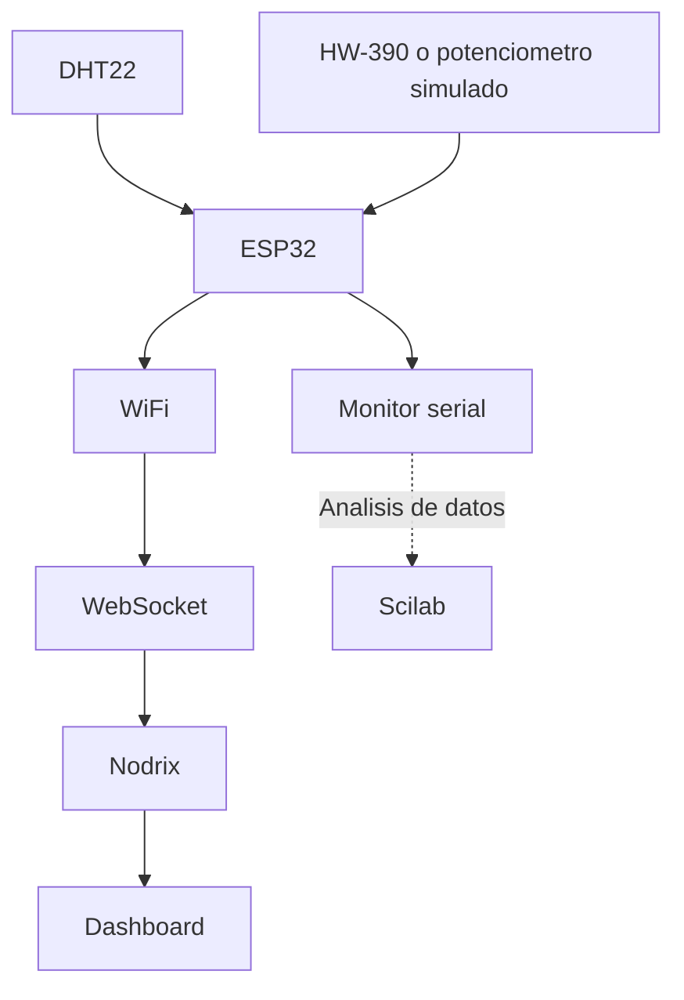

# Huerta Urbana Inteligente con ESP32 e IoT

## 1. Descripción del proyecto

Este proyecto académico de sensórica consiste en el desarrollo de un sistema de monitoreo para una huerta urbana utilizando un microcontrolador ESP32 y sensores que permiten conocer las condiciones ambientales y del suelo.

El sistema realiza la adquisición de datos de temperatura, humedad ambiental y humedad del suelo. Estas variables pueden visualizarse mediante el monitor serial y, en la versión IoT simulada, mediante un dashboard en Nodrix.

El proyecto también incluye el análisis matemático de los sensores mediante Scilab, la simulación del circuito en Wokwi y la implementación de un servidor Nodrix desplegado en Cloudflare Workers.

## 2. Objetivo general

Desarrollar un sistema de monitoreo para una huerta urbana mediante el uso de sensores, un microcontrolador ESP32 y herramientas IoT que permitan adquirir, analizar y visualizar las variables ambientales y del suelo.

### Objetivos específicos

- Implementar la lectura de temperatura y humedad ambiental mediante el sensor DHT22.
- Obtener lecturas analógicas de humedad del suelo mediante el sensor capacitivo HW-390.
- Analizar el comportamiento de los sensores mediante Scilab.
- Simular el funcionamiento del sistema utilizando Wokwi.
- Adaptar el repositorio base proporcionado por el docente.
- Transmitir las variables del sistema hacia Nodrix mediante WebSocket.
- Visualizar los datos mediante un dashboard en tiempo real.

## 3. Componentes electrónicos

| Componente | Función |
|---|---|
| ESP32 DevKit | Procesamiento y transmisión de datos |
| DHT22 | Medición de temperatura y humedad ambiental |
| HW-390 V2.0.0 | Sensor capacitivo de humedad del suelo |
| Protoboard | Montaje del circuito físico |
| Cables jumper | Conexión de los componentes |
| Potenciómetro | Representación del HW-390 en Wokwi |

## 4. Herramientas de software

| Herramienta | Aplicación dentro del proyecto |
|---|---|
| Arduino IDE | Programación inicial del ESP32 físico |
| Visual Studio Code | Desarrollo y modificación del firmware |
| PlatformIO | Gestión de librerías y compilación |
| Wokwi | Simulación del circuito electrónico |
| Scilab | Análisis matemático y curvas características |
| Mosquitto | Pruebas iniciales de comunicación MQTT |
| Nodrix | Recepción y visualización de datos IoT |
| Cloudflare Workers | Despliegue del servidor Nodrix |
| Git y GitHub | Control de versiones y almacenamiento |

## 5. Conexiones del circuito

### Sensor DHT22

| Pin del sensor | ESP32 |
|---|---|
| VCC | 3.3 V |
| DATA | GPIO 4 |
| GND | GND |

### Sensor capacitivo HW-390

| Pin del sensor | ESP32 |
|---|---|
| VCC | 3.3 V |
| AOUT | GPIO 34 |
| GND | GND |

El GPIO 34 se utiliza como entrada analógica para obtener las lecturas del sensor de humedad del suelo.

## 6. Variables del sistema

| Variable | Unidad | Rango de referencia |
|---|---|---|
| Temperatura ambiental | °C | -40 a 80 |
| Humedad ambiental | % HR | 0 a 100 |
| Humedad del suelo | ADC | 0 a 4095 |

El ESP32 utiliza una resolución ADC de 12 bits, lo que permite representar las entradas analógicas mediante 4096 niveles digitales.

La humedad del suelo se presenta inicialmente en unidades ADC, debido a que todavía se requiere una calibración experimental para convertir estas lecturas en porcentajes de humedad confiables.

## 7. Funcionamiento del sistema

El funcionamiento general se divide en las siguientes etapas:

1. Adquisición de datos mediante los sensores.
2. Procesamiento de las variables en el ESP32.
3. Visualización de las lecturas en el monitor serial.
4. Conexión del ESP32 a una red WiFi.
5. Transmisión de datos mediante WebSocket.
6. Recepción de las variables en Nodrix.
7. Visualización mediante indicadores y gráficas.

En la versión IoT simulada, el sistema está configurado para publicar las variables cada 5 segundos.

### Arquitectura del sistema



## 8. Pruebas experimentales

Durante la primera etapa se realizaron pruebas con el ESP32 físico y los sensores conectados al circuito.

Se evaluó el comportamiento del sensor capacitivo bajo diferentes condiciones de humedad.

| Condición experimental | Número de lecturas | ADC promedio |
|---|---:|---:|
| Sensor expuesto al aire | 3 | 3378.67 |
| Suelo ligeramente húmedo | 7 | 2991.00 |
| Suelo con mayor humedad | 16 | 2235.19 |

Los resultados muestran que la lectura ADC disminuye a medida que aumenta la humedad del suelo.

Estas mediciones permiten observar el comportamiento del sensor, pero no representan todavía una calibración absoluta de la humedad.

## 9. Análisis matemático en Scilab

Se desarrolló un programa en Scilab para estudiar el comportamiento de las variables entregadas por los sensores.

El análisis incluye:

- Representación gráfica de las variables.
- Curvas características.
- Regresión lineal.
- Regresión polinómica.
- Coeficiente de determinación R².
- Cálculo de errores.
- Comparación entre modelos matemáticos.

Los modelos desarrollados con datos simulados permiten estudiar el comportamiento esperado de los sensores. Su validación definitiva requiere mediciones experimentales con instrumentos de referencia.

## 10. Adaptación del repositorio base

Para desarrollar la etapa IoT se utilizó como punto de partida el repositorio proporcionado por el docente:

[Repositorio original - sensorica_blueprint](https://github.com/oscar88leonardo/sensorica_blueprint)

El diseño original utilizaba tres potenciómetros para representar variables de temperatura, humedad y luminosidad.

Para adaptarlo al proyecto de huerta urbana se realizaron las siguientes modificaciones:

- Incorporación del sensor DHT22.
- Eliminación de la variable de luminosidad.
- Incorporación de la variable de humedad del suelo.
- Configuración del GPIO 4 para el DHT22.
- Configuración del GPIO 34 como entrada ADC.
- Incorporación de las librerías del DHT22.
- Modificación de la estructura de datos.
- Adaptación de las funciones de telemetría.
- Modificación del diagrama de simulación.
- Configuración de un servidor Nodrix propio.

## 11. Simulación en Wokwi

La simulación está compuesta por:

- Un ESP32 DevKit.
- Un sensor DHT22.
- Un potenciómetro que representa la salida analógica del HW-390.

El potenciómetro permite modificar manualmente la lectura ADC para comprobar la respuesta del sistema ante diferentes condiciones simuladas de humedad del suelo.

También es posible modificar la temperatura y la humedad ambiental desde el DHT22 virtual.

La simulación permitió comprobar la adquisición de datos, la conexión WiFi y la transmisión de las variables hacia Nodrix.

## 12. Comunicación IoT con Nodrix

Se desplegó un servidor Nodrix mediante Cloudflare Workers para recibir los datos enviados por el ESP32 simulado.

La comunicación se realiza mediante WebSocket, utilizando un token de conexión asociado al proyecto.

Las variables registradas en Nodrix son:

| Variable | Descripción | Unidad |
|---|---|---|
| temperatura | Temperatura ambiental | °C |
| humedad | Humedad relativa ambiental | % HR |
| humedad_suelo | Lectura analógica del suelo | ADC |

La conexión y recepción de las tres variables fueron verificadas mediante la simulación en Wokwi.

## 13. Dashboard

Se diseñó un dashboard en Nodrix para visualizar las variables del sistema.

El dashboard contiene:

- Tres indicadores de valores numéricos.
- Tres indicadores tipo Gauge.
- Una gráfica de historial.

Los rangos configurados en los indicadores son:

| Indicador | Mínimo | Máximo |
|---|---:|---:|
| Humedad ambiental | 0 | 100 |
| Humedad del suelo | 0 | 4095 |
| Temperatura ambiental | 0 | 100 |

Durante las pruebas se modificaron manualmente las variables simuladas para comprobar que el dashboard actualizara correctamente sus indicadores.

Los valores extremos utilizados durante estas pruebas no corresponden a condiciones reales de cultivo.

## 14. Estructura del repositorio

```text
Proyecto_Sensorica_Huerta_Esp32_Iot/
│
├── firmware/
│   ├── huerta_esp32/
│   │   └── Firmware inicial
│   │
│   └── huerta_nodrix/
│       ├── include/
│       │   ├── config.h
│       │   └── secrets.h.example
│       ├── src/
│       │   ├── main.cpp
│       │   ├── sensors.cpp
│       │   ├── sensors.h
│       │   ├── telemetry.cpp
│       │   └── telemetry.h
│       ├── .gitignore
│       ├── diagram.json
│       ├── platformio.ini
│       └── wokwi.toml
│
├── scilab/
└── README.md
```

## 15. Instalación y ejecución

### Requisitos

- Git.
- Visual Studio Code.
- Extensión PlatformIO IDE.
- Extensión Wokwi para Visual Studio Code.
- Servidor Nodrix disponible.
- Token de conexión de Nodrix.

### Clonar el repositorio

```bash
git clone https://github.com/SergioAbeep/Proyecto_Sensorica_Huerta_Esp32_Iot.git
```

### Acceder al firmware IoT

```bash
cd Proyecto_Sensorica_Huerta_Esp32_Iot/firmware/huerta_nodrix
```

Abrir esta carpeta como proyecto en Visual Studio Code.

### Configurar las credenciales

Crear una copia del archivo:

`include/secrets.h.example`

Renombrar la copia como:

`include/secrets.h`

Configurar las credenciales correspondientes:

```cpp
#pragma once

#define WIFI_SSID "Wokwi-GUEST"
#define WIFI_PASS ""

#define NODRIX_HOST "TU_SERVIDOR.workers.dev"
#define NODRIX_TOKEN "TU_TOKEN_DE_CONEXION"
```

El archivo secrets.h contiene información privada y no debe publicarse en GitHub.

### Compilar el firmware

Desde una terminal de PlatformIO ejecutar:

```bash
pio run
```

Una vez finalizada la compilación, abrir diagram.json e iniciar la simulación mediante Wokwi.

Verificar la conexión en el monitor serial y comprobar la recepción de las variables en Nodrix.

## 16. Estado del proyecto

### Actividades realizadas

- [x] Selección de los componentes electrónicos.
- [x] Montaje inicial del circuito físico.
- [x] Programación inicial del ESP32.
- [x] Lectura de los sensores físicos.
- [x] Obtención de mediciones experimentales.
- [x] Desarrollo del análisis matemático en Scilab.
- [x] Configuración inicial de Mosquitto.
- [x] Adaptación del repositorio del docente.
- [x] Compilación mediante PlatformIO.
- [x] Simulación mediante Wokwi.
- [x] Despliegue de Nodrix en Cloudflare.
- [x] Conexión mediante WebSocket en simulación.
- [x] Transmisión de las tres variables simuladas.
- [x] Creación y prueba del dashboard.
- [x] Publicación del firmware en GitHub.

### Actividades pendientes

- [ ] Calibración experimental del sensor HW-390.
- [ ] Validación del DHT22 con instrumentos de referencia.
- [ ] Implementación del firmware IoT en el ESP32 físico.
- [ ] Validación de la transmisión de datos físicos a Nodrix.
- [ ] Configuración de la validación de certificados TLS.
- [ ] Integración de una pantalla OLED.
- [ ] Incorporación de evidencias fotográficas.
- [ ] Finalización del informe de laboratorio.

## 17. Seguridad

Las credenciales WiFi y los tokens de conexión se almacenan localmente en secrets.h.

Este archivo se encuentra excluido mediante .gitignore.

La configuración TLS sin validación de certificados utilizada durante las pruebas corresponde a un entorno de desarrollo y simulación. Para una implementación definitiva se debe habilitar la validación de certificados.

## 18. Evidencias del proyecto

En esta sección se incorporarán las siguientes evidencias:

- Montaje físico del circuito.
- Lecturas experimentales en Arduino IDE.
- Curvas características en Scilab.
- Compilación exitosa en PlatformIO.
- Diagrama del circuito en Wokwi.
- Conexión exitosa con Nodrix.
- Variables registradas en Nodrix.
- Dashboard final.
- Repositorio actualizado en GitHub.

## 19. Conclusiones

El desarrollo del proyecto permitió aplicar conocimientos de sensórica, programación de microcontroladores, adquisición de datos, análisis matemático y comunicación IoT.

Mediante las pruebas físicas se comprobó el comportamiento inicial de los sensores, mientras que la simulación permitió validar la transmisión y visualización remota de las variables mediante Nodrix.

Como siguiente etapa se espera integrar el firmware IoT con el circuito físico y completar la calibración de los sensores para obtener mediciones más confiables.

## 20. Autor y créditos

Proyecto académico de Ingeniería Electrónica.

Asignatura: Sensórica.

Desarrollado por: Sergio Andrés Muñoz Mendoza.

Repositorio base: sensorica_blueprint, proporcionado por el docente Oscar Leonardo.

La adaptación del firmware debe conservar los avisos de autoría y las condiciones de licencia del repositorio original.
