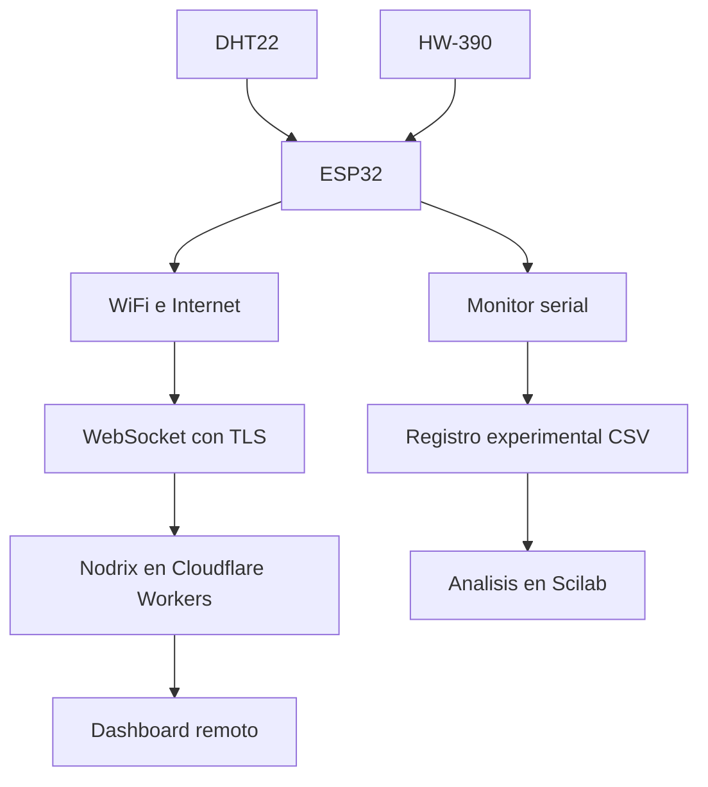
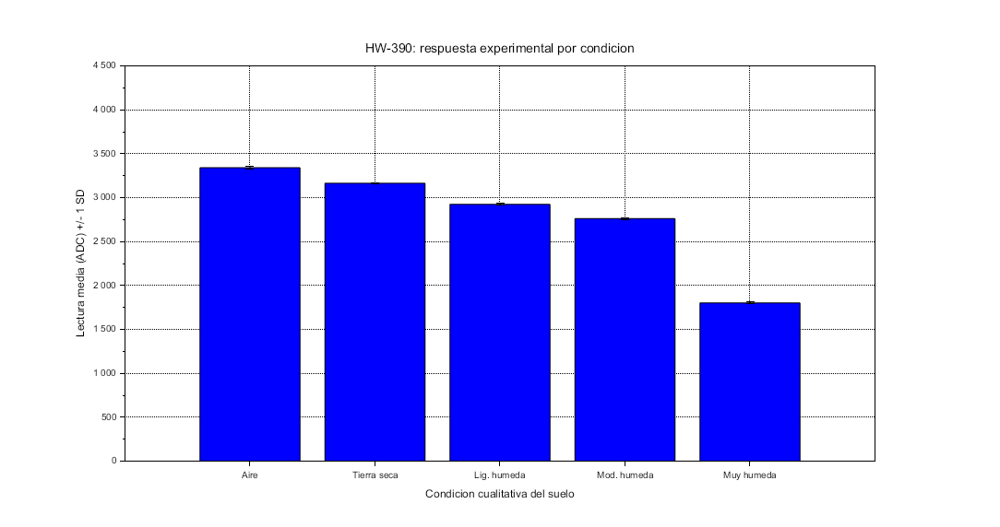
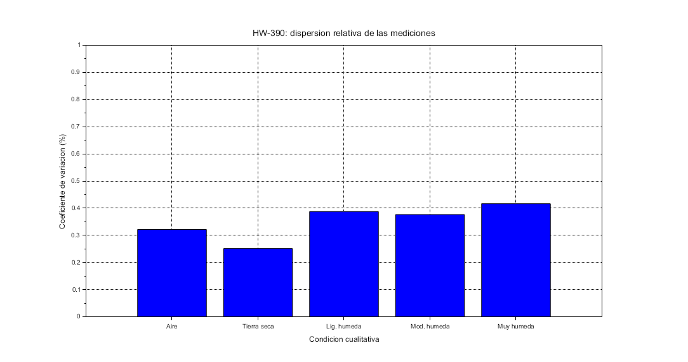

# Huerta Urbana Inteligente con ESP32 e IoT

Proyecto académico de la asignatura de Sensórica — Ingeniería Electrónica.

## Descripción

El proyecto consiste en un sistema de monitoreo de temperatura, humedad relativa ambiental y humedad del suelo para una huerta urbana. Utiliza un ESP32, un sensor DHT22 y un sensor capacitivo HW-390 V2.0.0. Las mediciones se muestran en el monitor serial y se transmiten mediante WiFi y WebSocket a Nodrix, desplegado en Cloudflare Workers.

Se desarrollaron una implementación física inicial, una simulación en Wokwi y una versión IoT probada con el ESP32 físico. Además, se procesaron 56 registros experimentales mediante Scilab para estudiar la respuesta y la dispersión de las mediciones.

## Objetivos

- Adquirir las tres variables del sistema mediante el ESP32.
- Adaptar el repositorio base del docente a la huerta urbana.
- Visualizar las mediciones remotamente mediante Nodrix.
- Configurar la validación de certificados TLS y la sincronización horaria NTP.
- Caracterizar experimentalmente la respuesta del HW-390 y analizar las mediciones en Scilab.

## Componentes y conexiones

| Componente | Función | Conexiones al ESP32 |
|---|---|---|
| ESP32 DevKit | Adquisición, procesamiento y comunicación WiFi | Alimentación USB |
| DHT22 | Temperatura y humedad relativa ambiental | VCC: 3V3; DATA: GPIO4; GND: GND |
| HW-390 V2.0.0 | Medición capacitiva de humedad del suelo | VCC: 3V3; AOUT: GPIO34; GND: GND |
| Protoboard y cables | Interconexión del circuito | Según el montaje |
| Potenciómetro virtual | Emulación de la salida del HW-390 en Wokwi | Señal analógica en GPIO34 |

El GPIO34 pertenece al ADC1 y permite la adquisición analógica mientras se utiliza WiFi. El ADC se configura con resolución de 12 bits (0–4095 cuentas). El DHT22 entrega mediciones digitales.

## Arquitectura



El firmware realiza adquisiciones cada 5 segundos. Al iniciar, conecta el ESP32 al WiFi, sincroniza la hora UTC mediante NTP y establece la sesión con Nodrix. En la prueba física se configuró el certificado CA ISRG Root X2 y se verificaron los mensajes de conexión y la recepción de las mediciones en el dashboard.

## Variables del sistema

| Identificador en Nodrix | Variable | Unidad | Rango de referencia |
|---|---|---|---|
| `temperatura` | Temperatura ambiental | °C | -40 a 80 |
| `humedad` | Humedad relativa ambiental | % HR | 0 a 100 |
| `humedad_suelo` | Lectura del HW-390 | ADC | 0 a 4095 |

La lectura del suelo permanece en unidades ADC; no se presenta como porcentaje real de humedad sin una calibración de referencia.

El dashboard contiene tres valores numéricos, tres indicadores tipo Gauge y una sola gráfica histórica con las tres variables, siguiendo la recomendación del docente. Las escalas de las variables son diferentes, lo que debe tenerse en cuenta al interpretar el historial conjunto.

## Herramientas utilizadas

Arduino IDE (pruebas iniciales), Visual Studio Code, PlatformIO, Wokwi, Nodrix, Cloudflare Workers, Scilab 2026.0.1, Git y GitHub. Mosquitto se utilizó en pruebas iniciales de MQTT; la integración IoT final descrita aquí utiliza WebSocket, no MQTT.

## Estructura del repositorio

```text
firmware/
├── huerta_esp32/                  # Firmware inicial
└── huerta_nodrix/                 # Firmware IoT
    ├── include/
    │   ├── config.h
    │   └── secrets.h.example
    ├── src/
    │   ├── main.cpp
    │   ├── sensors.cpp
    │   ├── sensors.h
    │   ├── telemetry.cpp
    │   └── telemetry.h
    ├── platformio.ini
    ├── diagram.json
    ├── wokwi.toml
    ├── .gitignore
    └── LICENSE
scilab/
├── datos_experimentales/
│   ├── mediciones_experimentales.csv
│   └── resumen_estadistico.csv
├── graficas/                      # Siete imágenes PNG
└── analisis_experimental.sce
README.md
```

Se conservan también los archivos anteriores de análisis y modelado de sensores en Scilab.

## Instalación y ejecución del firmware

### 1. Clonar y abrir el proyecto

```bash
git clone https://github.com/SergioAbeep/Proyecto_Sensorica_Huerta_Esp32_Iot.git
cd Proyecto_Sensorica_Huerta_Esp32_Iot/firmware/huerta_nodrix
```

Abrir esta carpeta en Visual Studio Code con la extensión PlatformIO IDE. Para simulación, instalar además la extensión Wokwi.

### 2. Configurar las credenciales

Copiar `include/secrets.h.example` como `include/secrets.h` y establecer los valores propios:

```cpp
#define WIFI_SSID "NOMBRE_DE_LA_RED"
#define WIFI_PASS "CONTRASENA_DE_LA_RED"
#define NODRIX_HOST "tu-servidor.workers.dev"
#define NODRIX_TOKEN "TU_TOKEN"
```

Para Wokwi, utilizar `Wokwi-GUEST` y una contraseña vacía. Para el ESP32 físico, utilizar una red WiFi de 2,4 GHz con acceso a Internet. El dominio debe escribirse sin `https://` ni una diagonal final. Se requiere un servidor Nodrix previamente desplegado y un token válido de su proyecto.

### 3. Configurar TLS

Identificar la autoridad certificadora raíz de la cadena TLS del servidor propio. En el montaje probado se utilizó ISRG Root X2, disponible en el [repositorio oficial de certificados de Let's Encrypt](https://letsencrypt.org/certificates/). El certificado correcto puede variar según el servidor y sus renovaciones.

Agregar el certificado PEM completo a `secrets.h` con esta estructura (sustituir el texto de ejemplo):

```cpp
static const char nodrix_ca_cert[] = R"PEM(-----BEGIN CERTIFICATE-----
CONTENIDO_REAL_DEL_CERTIFICADO
-----END CERTIFICATE-----
)PEM";
#define NODRIX_CA_CERT nodrix_ca_cert
```

El firmware selecciona `Nodrix.setCACert()` cuando se define `NODRIX_CA_CERT`. La sincronización NTP se realiza antes de iniciar la conexión WebSocket. No utilizar el modo `setInsecure()` para una implementación real con credenciales, pues no verifica la identidad del servidor.

**No publicar `secrets.h`, tokens, contraseñas ni binarios compilados con credenciales.**

### 4. Compilar, simular o cargar

```bash
pio run
```

Para simular, iniciar Wokwi con `diagram.json` y `wokwi.toml` desde Visual Studio Code. El potenciómetro virtual representa la señal analógica del HW-390.

Para el montaje físico, conectar el ESP32 por USB y comprobar el puerto con `pio device list`. El archivo `platformio.ini` contiene COM7, que corresponde al computador utilizado en las pruebas; cambiar o eliminar `upload_port` y `monitor_port` si el puerto es distinto.

```bash
pio run -t upload
pio device monitor
```

El monitor serial trabaja a 115200 baudios. Comprobar la conexión WiFi, la sincronización NTP, la sesión WebSocket y las mediciones. En Nodrix, verificar la recepción de las variables. Detener la simulación cuando se utilice el dispositivo físico para evitar mezclar ambos orígenes de datos.

## Resultados experimentales

El 24 de noviembre de 2026 se registraron 56 mediciones seleccionadas en cinco condiciones cualitativas, con un intervalo de adquisición de 5 segundos. Los registros conservan sus tiempos originales, incluidos los intervalos sin muestras disponibles.

| Condición | n | Media ADC | Desviación estándar muestral (ADC) | CV (%) | Temperatura media (°C) | HR media (%) |
|---|---:|---:|---:|---:|---:|---:|
| Aire | 10 | 3341,00 | 10,75 | 0,322 | 27,83 | 43,61 |
| Tierra seca | 10 | 3164,30 | 7,96 | 0,252 | 27,96 | 43,38 |
| Tierra ligeramente húmeda | 12 | 2924,00 | 11,33 | 0,387 | 28,17 | 43,26 |
| Tierra moderadamente húmeda | 12 | 2761,75 | 10,39 | 0,376 | 28,33 | 42,76 |
| Tierra muy húmeda | 12 | 1802,00 | 7,51 | 0,417 | 28,60 | 42,76 |



La señal media disminuyó 1539 cuentas ADC (46,06 %) entre aire y tierra muy húmeda, y 1362,30 cuentas (43,05 %) entre tierra seca y muy húmeda. Estos porcentajes corresponden a reducciones de la señal, no a humedad real del suelo. Los coeficientes de variación inferiores a 0,5 % indican baja dispersión a corto plazo en las condiciones ensayadas, pero no prueban exactitud metrológica.

## Análisis en Scilab

Abrir `scilab/analisis_experimental.sce` en SciNotes y ejecutar con F5, conservando la estructura de carpetas. El programa importa las mediciones, calcula los parámetros estadísticos, compara el resumen CSV y exporta siete imágenes a `scilab/graficas/`. La ejecución fue verificada en Scilab 2026.0.1.

**Datos:** [Mediciones individuales](scilab/datos_experimentales/mediciones_experimentales.csv) · [Resumen estadístico](scilab/datos_experimentales/resumen_estadistico.csv).

**Gráficas:**

1. [Respuesta del HW-390 con barras de error](scilab/graficas/01_respuesta_hw390.png).
2. [Serie temporal del suelo](scilab/graficas/02_serie_suelo.png).
3. [Serie temporal de temperatura](scilab/graficas/03_serie_temperatura.png).
4. [Serie temporal de humedad ambiental](scilab/graficas/04_serie_humedad_ambiental.png).
5. [Repetibilidad mediante coeficiente de variación](scilab/graficas/05_repetibilidad.png).
6. [Distribución tridimensional de frecuencias](scilab/graficas/06_distribucion_3d.png).
7. [Cambios ADC entre condiciones](scilab/graficas/07_cambios_adc.png).



El análisis experimental se mantiene separado de los modelos matemáticos simulados desarrollados previamente. Las condiciones del suelo no representan una escala cuantitativa de humedad.

## Estado y limitaciones

- [x] Montaje y adquisición de datos físicos.
- [x] Adaptación del firmware base y simulación en Wokwi.
- [x] Despliegue de Nodrix y dashboard.
- [x] Implementación física de la comunicación IoT con configuración TLS y NTP.
- [x] Caracterización cualitativa del HW-390 mediante cinco condiciones.
- [x] Procesamiento de 56 mediciones y generación de siete gráficas en Scilab.
- [ ] Calibración cuantitativa del HW-390 con humedad conocida.
- [ ] Validación de exactitud del DHT22 con instrumentos de referencia.

El monitoreo remoto se validó con el montaje físico alimentado por USB. No se realizaron pruebas específicas de autonomía sin computador, estabilidad prolongada ni reconexión ante pérdidas de red. El riego automático, la pantalla OLED y las alertas quedan como posibles ampliaciones.

## Conclusión

Se consiguió implementar un prototipo funcional capaz de adquirir variables ambientales y del suelo y transmitirlas a un dashboard IoT. Las mediciones experimentales del HW-390 mostraron una disminución progresiva de la señal ADC conforme aumentó la humedad cualitativa del suelo. El análisis en Scilab permitió estudiar la respuesta y la repetibilidad a corto plazo. Para establecer curvas de calibración cuantitativas y determinar la exactitud de los sensores, se requieren mediciones independientes de referencia.

## Créditos y licencia

Proyecto académico de Sensórica — Ingeniería Electrónica.

La versión IoT adapta el repositorio base [sensorica_blueprint](https://github.com/oscar88leonardo/sensorica_blueprint), proporcionado por el docente. Se conserva su licencia GNU GPLv3 en [`firmware/huerta_nodrix/LICENSE`](firmware/huerta_nodrix/LICENSE) y deben mantenerse los avisos de autoría originales.

Modificaciones de la adaptación, noviembre de 2026: incorporación del DHT22 y del HW-390, cambios de pines y variables, adaptación del diagrama de Wokwi y de la telemetría, configuración de un servidor Nodrix propio, sincronización NTP y configuración de validación TLS para la implementación física.
